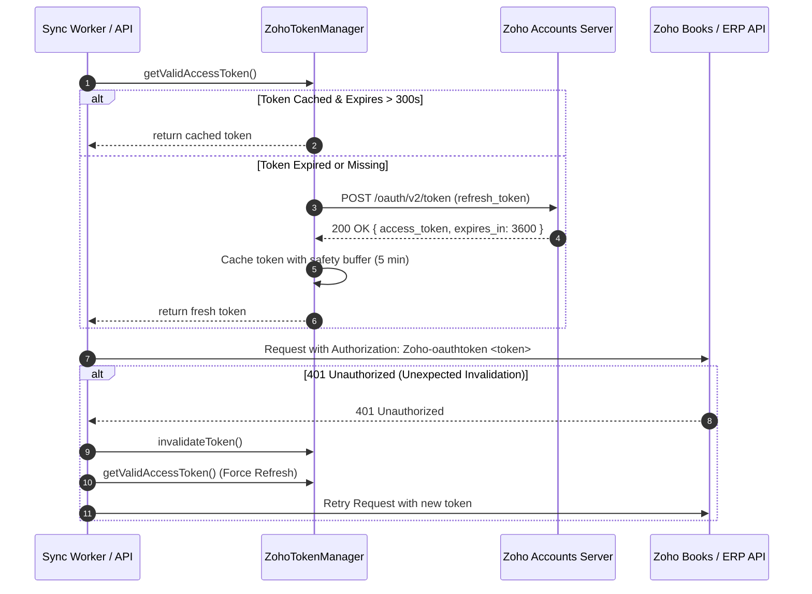
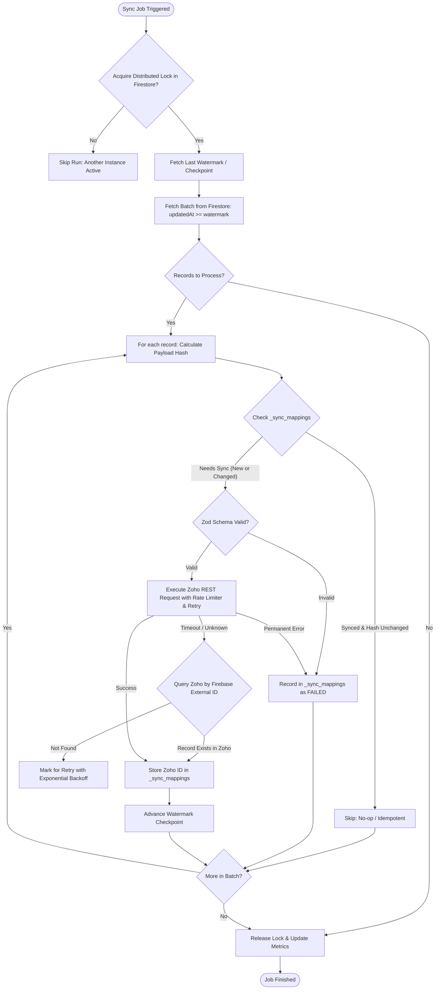

# Firebase to Zoho ERP Sync Architecture & Design Specification

## 1. Executive Summary

This document specifies the technical design, data mapping, distributed synchronization patterns, and operational guardrails for the **Firebase-to-Zoho ERP Standalone Sync API**.

The service operates as a daemonized background synchronization worker paired with a secured REST administrative API. It reads data from Google Cloud Firestore, validates and maps business records, guarantees idempotent creation and updates in Zoho ERP (Zoho Books / Zoho Inventory / Zoho CRM), and prevents duplicate operations through durable state tracking in Firestore.

---

## 2. Source Database Inspection & Analysis

Based on codebase inspection of the existing CRM frontend (`dummycrm`):

- **Database Engine**: Google Cloud Firestore (Firebase Admin SDK v12+).
- **Project ID**: `my-portfolio-e1326` (configurable via `FIREBASE_PROJECT_ID`).
- **Data Entities**:
  1. `customers`: Contains client companies and contact individuals.
  2. `rfqs`: Contains Request for Quotation records, tracking lifecycle from Draft to Sales Order, along with multi-line items (`productLines`), attachments, and audit activities.
- **Tenant Isolation**: Configurable optional `tenantId` / `companyId` scoping for multi-organization partitioning.

### Source Schema Breakdown

```typescript
// Customer Entity (Collection: 'customers')
interface Customer {
  id: string;               // e.g., 'c-1'
  name: string;             // e.g., 'Aarav Controls'
  contact: string;          // e.g., 'Rohit Mehta' (Primary contact person)
  email: string;            // e.g., 'rohit@aaravcontrols.com'
  phone: string;            // e.g., '+91 98765 12345'
  company: string;          // e.g., 'Aarav Controls'
  tenantId?: string;        // Optional multi-tenant discriminator
  createdAt?: string;       // ISO-8601 string or Firestore Timestamp
  updatedAt?: string;       // ISO-8601 string or Firestore Timestamp
}

// Product Line Item (Embedded within RFQ or standalone 'products')
interface ProductLine {
  sku: string;              // e.g., 'CPA-08-A'
  description: string;      // e.g., 'Assembly enclosure'
  qty: number;              // e.g., 180
  unitPrice: number;        // e.g., 420.00
  total: number;            // e.g., 75600.00
}

// RFQ Entity (Collection: 'rfqs')
interface Rfq {
  id: string;               // e.g., 'rfq-001'
  rfqNumber: string;        // e.g., 'RFQ-2026-001'
  customerId: string;       // FK -> customers.id
  customerName: string;     // Denormalized customer company name
  productName: string;      // Primary deliverable title
  partNumber: string;       // Primary assembly part number
  quantity: number;
  targetDeliveryDate: string; // YYYY-MM-DD
  status: RfqStatus;        // 'Draft' | 'Approved' | 'Quoted to Customer' | 'Sales Order' | ...
  stage: Stage;             // Lifecycle stage
  assignee: string;
  department: string;
  totalValue: number;
  salesOrderNumber?: string;// e.g., 'SO-2026-014' (present when won/converted)
  invoiceId?: string;       // e.g., 'INV-2026-091' (present when invoiced)
  notes: string[];
  productLines: ProductLine[];
  createdAt: string;
  updatedAt: string;
}
```

---

## 3. Destination Entity Mapping (Zoho Books / Inventory / CRM)

The primary ERP target is **Zoho Books / Inventory** (Zoho Finance API v3). The modular architecture also provides a dedicated adapter for **Zoho CRM** (v6).

### 3.1 Customer -> Zoho Contact

| Firestore `customers` Field | Zoho Books `contacts` Field | Transform / Validation Logic |
|---|---|---|
| `id` | `custom_fields` (`cf_firebase_id`) & `notes` | Required for correlation & idempotency |
| `company` \|\| `name` | `company_name` | Max 200 chars, trimmed |
| `name` \|\| `contact` | `contact_name` | Primary display name in Zoho |
| `contact` | `contact_persons[0].first_name` | Extracted first/last name |
| `email` | `email` & `contact_persons[0].email` | Validated email format |
| `phone` | `phone` & `contact_persons[0].phone` | Cleaned phone string |
| `tenantId` | `custom_fields` (`cf_tenant_id`) | Multi-tenant tracking |

### 3.2 ProductLine -> Zoho Item

| Firestore `productLines` Field | Zoho Books `items` Field | Transform / Validation Logic |
|---|---|---|
| `sku` | `sku` | Unique item identifier in Zoho ERP |
| `description` \|\| `sku` | `name` | Mandatory item name |
| `description` | `description` | Optional detail text |
| `unitPrice` | `rate` | Non-negative numeric float |
| N/A | `product_type` | `'goods'` |
| N/A | `item_type` | `'inventory'` |

### 3.3 RFQ (Sales Order / Invoice) -> Zoho Sales Order / Invoice

| Firestore `rfqs` Field | Zoho Books `salesorders` Field | Transform / Validation Logic |
|---|---|---|
| `id` | `reference_number` / custom field | Used to verify if duplicate exists on timeout |
| `salesOrderNumber` \|\| `rfqNumber` | `salesorder_number` | Unique SO number |
| `customerId` | `customer_id` | Resolved from internal `_sync_mappings` table |
| `createdAt` | `date` | YYYY-MM-DD format |
| `targetDeliveryDate` | `shipment_date` | YYYY-MM-DD format |
| `productLines` | `line_items` | Array of `{ item_id, name, rate, quantity }` |
| `notes` | `notes` | Joined string |

---

## 4. Zoho OAuth 2.0 Token Lifecycle



---

## 5. Synchronization & Idempotency Pipeline



---

## 6. Durable State Storage (No Redis / No Postgres Needed)

To maintain extreme reliability without unnecessary operational dependencies, all sync state is managed in dedicated Firestore collections:

1. `_sync_mappings`: Maps source Firebase document ID to destination Zoho record ID, payload hash, attempt count, last sync timestamp, and last error.
2. `_sync_checkpoints`: Tracks high-watermark timestamp per entity type to support resilient incremental streaming.
3. `_sync_locks`: Implements distributed mutual exclusion (mutex) with atomic transactions and lease expiration (TTL) to prevent overlapping cron runs across multiple Docker containers.
4. `_sync_logs`: Historical audit trail of full/incremental runs, counts, durations, and partial failures.
